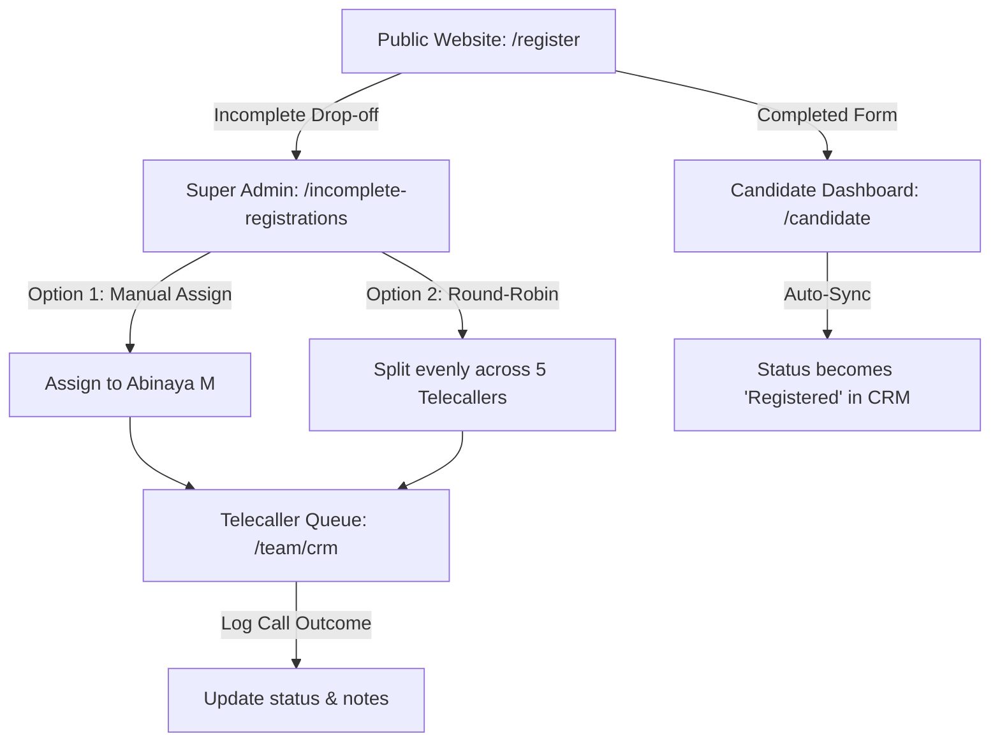

# TNEDMS End-to-End Physical Testing Playbook

> **Target Environment:** Staging  
> **Base URL:** [https://tnedms.online](https://tnedms.online)  
> **Direct Access:** HTTP Basic Auth is completely disabled. No username/password browser alert will appear.

---

## 1. Test Credentials & Environments

### Super Admin Portal
* **URL:** [https://tnedms.online/login](https://tnedms.online/login)
* **Username:** `admin`
* **Password:** `UL5-q9SmiZLcSp9l`
* **Default Page:** `/dashboard`

### Telecaller Logins (5 Active Telecallers)
*All accounts use passcode `123456`.*

| Telecaller Name | Username | Password | Dedicated Workspace |
| :--- | :--- | :--- | :--- |
| **Abinaya M** | `abinaya` | `123456` | [https://tnedms.online/team/crm](https://tnedms.online/team/crm) |
| **Yuvasri** | `yuvasri` | `123456` | [https://tnedms.online/team/crm](https://tnedms.online/team/crm) |
| **Omsree** | `omsree` | `123456` | [https://tnedms.online/team/crm](https://tnedms.online/team/crm) |
| **Sathiya Priya I** | `sathiyapriya` | `123456` | [https://tnedms.online/team/crm](https://tnedms.online/team/crm) |
| **A. Vedha Priya** | `vedhapriya` | `123456` | [https://tnedms.online/team/crm](https://tnedms.online/team/crm) |

### Sample Registered Candidate Login
* **Username:** `cand_0035` *(Mobile: `9840100035`)*
* **Passcode:** `123456`
* **Candidate Portal:** [https://tnedms.online/candidate](https://tnedms.online/candidate)

---

## 2. Step-by-Step Testing Scenarios

---

### Test Scenario 1: Incomplete Registration Drop-Off
**Objective:** Verify that when someone starts the registration form on the website and leaves before finishing, their details are captured as a lead.

1. Open an **Incognito / Private browser window**.
2. Go to [https://tnedms.online/register](https://tnedms.online/register).
3. Fill in **Step 1 (Basic Details)**:
   * **Full Name:** `Murugan Test`
   * **Mobile Number:** Any test 10-digit number (e.g. `9840998811`)
4. Click **Next** to move to Step 2.
5. **Immediately close the browser tab** (simulating user drop-off).
6. Open your regular browser, log in as Super Admin (`admin` / `UL5-q9SmiZLcSp9l`), and visit:  
   [https://tnedms.online/incomplete-registrations](https://tnedms.online/incomplete-registrations)
7. **Verification Checks:**
   * [ ] `Murugan Test` (`9840998811`) is listed under the **"To follow up"** tab.
   * [ ] **Source** badge displays **Website**.
   * [ ] **How far they got** accurately reflects the step reached.

---

### Test Scenario 2: Super Admin Lead Assignment & Round-Robin
**Objective:** Verify that Super Admin can assign leads both manually and automatically via Round-Robin.

#### Part A: Manual Assignment
1. On [https://tnedms.online/incomplete-registrations](https://tnedms.online/incomplete-registrations), locate the lead `Murugan Test`.
2. Find the **Assigned Telecaller** dropdown column.
3. Select **`Abinaya M`** from the list.
4. **Verification Checks:**
   * [ ] Dropdown changes to `Abinaya M` without error.
   * [ ] Refreshing the page keeps `Abinaya M` selected.

#### Part B: Round-Robin Automated Distribution
1. Look at the top right of the page header on `/incomplete-registrations`.
2. Click the blue **"Distribute (Round-Robin)"** button.
3. Click **OK** on the confirmation dialog.
4. **Verification Checks:**
   * [ ] A success popup appears stating how many unassigned leads were distributed across the 5 active team members.
   * [ ] The unassigned leads now have telecallers assigned in equal rotation (`Abinaya M` -> `Yuvasri` -> `Omsree` -> `Sathiya Priya I` -> `A. Vedha Priya`).

---

### Test Scenario 3: Telecaller Workspace & Queue Isolation
**Objective:** Verify that each telecaller only sees their assigned leads, and call logs/notes save properly.

1. In a separate browser profile or Incognito tab, go to [https://tnedms.online/login](https://tnedms.online/login).
2. Log in as telecaller **`abinaya`** (password: `123456`).
3. You will be redirected to the workspace: [https://tnedms.online/team/crm](https://tnedms.online/team/crm).
4. **Verification Checks (Queue Isolation):**
   * [ ] Workspace header shows `Abinaya M`.
   * [ ] All conversations listed belong to `Abinaya M`.
   * [ ] `Murugan Test` (assigned in Scenario 2) appears in her list.
5. **Call Logging Test:**
   * Click on `Murugan Test` to open the right-side detail drawer.
   * Under Call Outcomes, click **"Interested"** or **"Will call back"**.
   * In the note box, type: `"Contacted candidate. Requested party booth briefing."`
   * Click **Save / Update**.
   * Verify the note and timestamp appear in the history.
6. **Cross-Agent Isolation Check:**
   * Log out from `abinaya`.
   * Log in as telecaller **`yuvasri`** (password: `123456`).
   * Navigate to [https://tnedms.online/team/crm](https://tnedms.online/team/crm).
   * **Verification:** Confirm `Murugan Test` does **not** appear in Yuvasri's queue (strict isolation confirmed).

---

### Test Scenario 4: Full Candidate Registration & Dashboard
**Objective:** Verify that completing registration activates the candidate account and automatically marks the CRM lead as "Registered".

1. Go to [https://tnedms.online/register](https://tnedms.online/register).
2. Complete all registration steps with realistic details:
   * **Name:** `Selvam Candidate`
   * **Mobile Number:** E.g., `9840998822`
   * **Role / Position:** Candidate
   * **District & Assembly:** E.g., `Chennai` / `Harbour`
   * **Party:** E.g., `DMK` / `AIADMK` / `Independent`
   * **Passcode:** `123456`
3. Click **Submit** to finish registration.
4. Log in as the new candidate at [https://tnedms.online/login](https://tnedms.online/login):
   * Username / Mobile: `9840998822`
   * Passcode: `123456`
5. **Candidate Portal Verification:**
   * [ ] You are redirected to `/candidate`.
   * [ ] Assembly overview (`Harbour`), Voter distribution, and Gender/Age statistics display properly.
6. **CRM Automatic Status Verification:**
   * In the Super Admin browser, go to [https://tnedms.online/incomplete-registrations](https://tnedms.online/incomplete-registrations).
   * Click on the **"Registered"** tab.
   * **Verification:** `Selvam Candidate` (`9840998822`) is now under the **"Registered"** tab with a green `Registered <date>` pill.

---

### Test Scenario 5: WhatsApp Re-Engagement Recognition
**Objective:** Understand how WhatsApp synchronization works for registered candidates.

* **Previous Bug:** When a registered user sent `"Hi"` on WhatsApp, the bot treated it as a reset keyword, deleted their session, and prompted them to register from scratch.
* **New Behavior (Verified):**
  * When a number that already exists in `tbl_user` messages `"Hi"` or `"வணக்கம்"`:
  * The system immediately recognizes them as registered.
  * Sends back their username + passcode + direct login link (`https://tnedms.online/login`).
  * If unpaid, it provides payment instructions.
  * **Never** prompts them to fill out the registration questionnaire again.

---

## 3. Physical Tester Sign-Off Sheet

| # | Test Item | Target URL | Expected Result | Pass / Fail |
| :--- | :--- | :--- | :--- | :---: |
| 1 | Direct access (No HTTP Basic Auth prompt) | `https://tnedms.online` | Page opens directly without prompt | [ ] |
| 2 | Incomplete website registration capture | `/incomplete-registrations` | Lead appears under "To follow up" | [ ] |
| 3 | Manual telecaller assignment dropdown | `/incomplete-registrations` | Assigns lead to selected agent | [ ] |
| 4 | "Distribute (Round-Robin)" action | `/incomplete-registrations` | Distributes evenly across 5 agents | [ ] |
| 5 | Telecaller login & queue isolation | `/team/crm` | Telecaller sees only their leads | [ ] |
| 6 | Call logging & notes drawer | `/team/crm` | Outcome and note saved to history | [ ] |
| 7 | Full candidate registration flow | `/register` -> `/candidate` | Candidate dashboard loads cleanly | [ ] |
| 8 | Registered status auto-synchronization | `/incomplete-registrations?tab=registered` | Lead moves to "Registered" tab | [ ] |

---
**Tester Name:** ________________________  
**Date of Testing:** ________________________  
**Status:** [ ] Accepted  [ ] Changes Required
